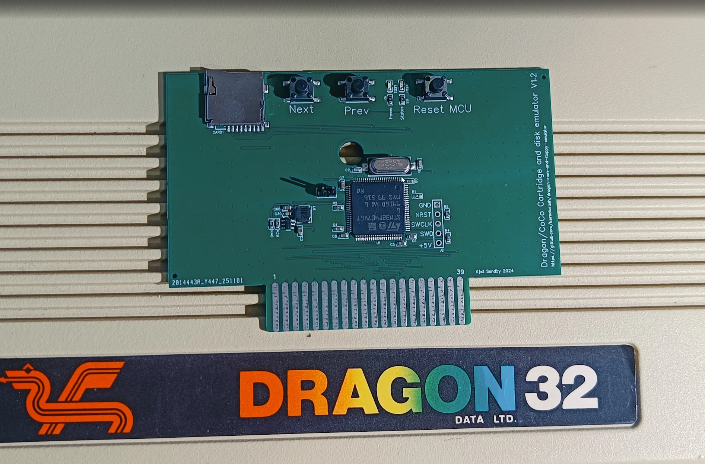
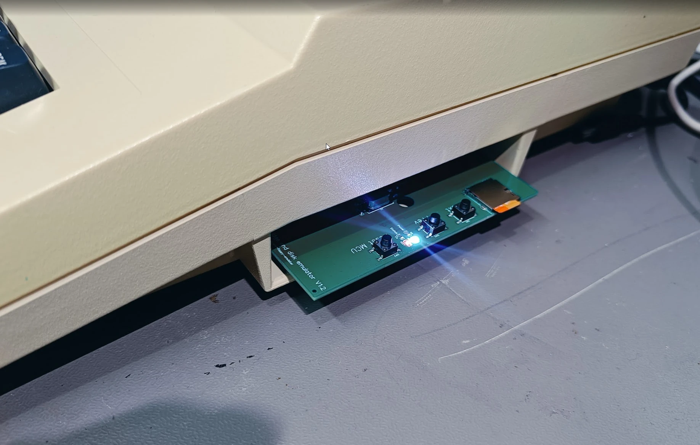

# Dragon / CoCo ROM and Floppy Emulator: User Manual

This manual is for people who have a working board and want to use it. How to build and wire
the board, and how it works inside, is in [README.md](README.md).

The emulator is an STM32F407 board in the cartridge port of a Dragon 32/64 or a Tandy Color
Computer (CoCo 1/2). It reads a micro SD card and gives the computer:

- ROM cartridges (`.rom`, `.ccc`, `.bin`)
- two floppy drives, A and B (`.dsk`, `.vdk` disk images), with DragonDOS or RS-DOS
- cassette programs (`.cas`), loaded straight into memory
- optionally a BASIC ROM of your own in place of the computer's (`dragon.rom`, `coco.rom`)
- a menu to pick from all of the above

## The board



The *Dragon/CoCo Cartridge and disk emulator* fits a standard cartridge case. Boards can be had
for a small sum: get in touch with [@sundbyk](https://github.com/sundbyk) on GitHub.

| Part              | What it is for |
|-------------------|----------------|
| micro SD slot     | The card with the menu, DOS ROMs, games and disks (section 1). |
| Next / Prev       | Step to the next or previous ROM or disk without the menu (section 9). |
| Reset MCU         | Restarts the emulator itself. Use it after changing the SD card. |
| Power LED         | The board has power. |
| Status LED        | Flickers while new firmware is being written. A steady blink means something is wrong (section 12). |
| Jumper            | Dragon or CoCo mode (section 2). |
| GND NRST SWCLK SWD +5V | SWD header for an ST-Link, to put the firmware on a new board. |

Always plug the board in and out with the computer switched off.

On board **V1.2**, cartridge pin 40 is not connected, so a BASIC ROM of your own (section 8)
can not be used. Leave `dragon.rom` and `coco.rom` off the SD card.



## Contents

1. [Preparing the SD card](#1-preparing-the-sd-card)
2. [Dragon or CoCo mode](#2-dragon-or-coco-mode)
3. [Starting up](#3-starting-up)
4. [The menu](#4-the-menu)
5. [Disks and the two drives](#5-disks-and-the-two-drives)
6. [Cartridges](#6-cartridges)
7. [Cassettes](#7-cassettes)
8. [A BASIC ROM of your own](#8-a-basic-rom-of-your-own)
9. [The NEXT and PREV buttons](#9-the-next-and-prev-buttons)
10. [Covers](#10-covers)
11. [Updating the firmware and the menu](#11-updating-the-firmware-and-the-menu)
12. [Troubleshooting](#12-troubleshooting)

## 1. Preparing the SD card

Format the card as FAT32. A small partition (under 1 GB) is plenty. Then lay it out like this:

```
/                      root of the SD card
├── menu.rom           the menu (from the menu folder)
├── dragondos.rom      DOS for Dragon mode: DragonDOS 1.0, SuperDOS ...
├── tandydos.rom       DOS for CoCo mode: Disk Extended Color BASIC 1.1 (disk11.rom)
├── dragon.rom         optional: a Dragon BASIC ROM of your own (16K)
├── coco.rom           optional: a CoCo BASIC ROM of your own (8K or 16K)
├── dragon/            everything for Dragon mode
│   ├── Games/
│   │   ├── Arcade/
│   │   └── ...
│   └── ...
└── tandy/             everything for CoCo mode
    └── ...
```

- Only `.rom`, `.ccc`, `.bin`, `.dsk`, `.vdk` and `.cas` files show up in the menu.
  Hidden files and names starting with `.` (such as the `._` files macOS leaves behind) are
  skipped.
- Use as many folders as you like. A folder can hold up to 1800 entries.
- **tandydos.rom must be plain Disk BASIC 1.1** (often called `disk11.rom`). HDB-DOS and other
  hard disk versions stop with `HARD DRIVE(S) NOT FOUND`.

## 2. Dragon or CoCo mode

A jumper on the board chooses the machine:

| Jumper    | Mode   | Folder    | DOS ROM         |
|-----------|--------|-----------|-----------------|
| off       | Dragon | `dragon/` | `dragondos.rom` |
| on (GND)  | CoCo   | `tandy/`  | `tandydos.rom`  |

The top line of the menu shows which mode the board is in. If both `dragon.rom` and `coco.rom`
are on the card, the choice you make at start up sets the mode (see section 8).

## 3. Starting up

1. Put the SD card in the board.
2. Plug the board into the cartridge port **with the computer switched off**.
3. Switch on.

The menu appears. The top line reads something like:

```
 MENU 2.2.11   FW 1.2.15  DRAGON
```

That is the menu version, the firmware version and the mode.

It helps to power the board separately from the computer (keep GND connected). Then you can
switch the computer off and on without the board forgetting where it was.

**Pressing RESET on the computer brings the menu back.**

## 4. The menu

The menu shows one folder at a time, 12 entries per page. The coloured block in front of each
name tells you what it is:

| Block   | Meaning           |
|---------|-------------------|
| yellow  | folder (or `..`)  |
| cyan    | disk image        |
| magenta | ROM cartridge     |
| white   | cassette (`.cas`) |

The row under the title shows the disk in drive B, if there is one. The row under the list
shows the folder you are in.

### Keys

| Key             | What it does |
|-----------------|--------------|
| UP / DOWN       | Move up and down the list. Held down, they repeat. |
| LEFT / RIGHT    | Previous / next page. |
| letters, digits | Jump to the first name starting with what you have typed. |
| CLEAR           | Start typing the name again. |
| SPACE           | Show or hide the file sizes. Once you have started typing a name, SPACE is part of it. |
| @               | Show the cover. ENTER then starts the game, any other key goes back. |
| ENTER           | Open the folder, or start the ROM, disk or cassette. A disk goes in drive A. |
| SHIFT+ENTER     | On a disk: put it in **drive B**, or take it out if it is already there. |
| BREAK           | Go up one folder. In the top folder: leave the menu and go to BASIC. |

When you come back to the menu it opens in the folder, and on the entry, you last started.

## 5. Disks and the two drives

### Starting a disk (drive A)

Select a disk and press ENTER. The computer restarts with the DOS cartridge and the disk in
drive A.

- **Dragon:** the disk usually starts by itself. The emulator looks in the directory and
  types `RUN"M"`, `BOOT` or whatever the disk seems to want. To choose the command yourself,
  put a text file next to the disk with the same name and `.run` instead of `.vdk`/`.dsk`
  (for example `Elite.run` next to `Elite.vdk`) with the command on its first line, such as
  `RUN"ELITE"`. An empty `.run` file means nothing is typed. A file called `autoboot.off` in
  the root of the card turns this off for all disks.
- **CoCo:** you get Disk BASIC's `OK`. Type `DIR` and `RUN"name"` or `LOADM"name":EXEC`.

### Drive B

1. In the menu, select a disk and press **SHIFT+ENTER**. The menu stays where it is, and the
   row under the title shows `B: NAME`.
2. Select the disk for drive A and press ENTER as usual.

The disk in drive B stays there when you reset or start another disk in drive A. To take it
out, press SHIFT+ENTER on the same disk again.

| DOS       | Drive A | Drive B | Example          |
|-----------|---------|---------|------------------|
| DragonDOS | 1       | 2       | `DIR 2`          |
| RS-DOS    | 0       | 1       | `DIR 1`          |
| OS-9      | /D0     | /D1     | `dir /d1`        |

Drives 3 and 4 (DragonDOS) or 2 and 3 (RS-DOS) answer "not ready".

### Saving

Whatever the computer writes to a disk is written back to the image file on the SD card a
moment later. Before you switch off or take the card out, wait a second or two after the
last write.

### Disk images

- `.dsk`: plain sector dumps, 18 sectors of 256 bytes per track. 35 or 40 tracks single
  sided, 40 or 80 tracks double sided.
- `.vdk`: Dragon disk images with a header.

### OS-9 and NitrOS-9

OS-9 needs 64K of RAM: a CoCo with 64K, or a Dragon 64. A Dragon 32 can not run it.

## 6. Cartridges

Select a `.rom`, `.ccc` or `.bin` file and press ENTER. The computer restarts with that
cartridge in the port.

## 7. Cassettes

Select a `.cas` file and press ENTER. The menu loads the tape straight into memory (no tape,
no waiting) and starts it:

- **Machine code** is loaded and run. If it returns you get BASIC's `OK`, and `EXEC` runs it
  again.
- **A BASIC program** is loaded and `RUN` is typed for you.

Tapes that load more from tape themselves (a BASIC loader that does `CLOADM`, turbo loaders,
copy protection, most CoCo games) do not work as they are: you get stripes or a hang. They
can be converted with `tools/cas_snapshot.py`, which loads the tape in the XRoar emulator and
saves the machine as it is just after loading. Section "Tapes with their own loaders" in
[README.md](README.md) explains how, for both Dragon and CoCo tapes. Games that load more
later (new levels from tape) can not be converted.

## 8. A BASIC ROM of your own

Put `dragon.rom` (Dragon mode) or `coco.rom` (CoCo mode) in the root of the card and it is
used instead of the computer's own BASIC ROM. This needs cartridge pin 40 (!DSD) wired to the
board. **Without that wire, do not put these files on the card.** Board V1.2 does not have it.

- `dragon.rom`: 16K, for $8000-$BFFF.
- `coco.rom`: 16K (Extended Color BASIC followed by Color BASIC) or 8K (Color BASIC only).
  If the two halves are the wrong way round, the emulator swaps them.

### Both on the card

With both `dragon.rom` and `coco.rom` on the card the menu asks at start up:

```
WHICH BASIC?
1  DRAGON.ROM
2  COCO.ROM
3  BUILT IN
```

Your choice also sets the mode (folder, DOS ROM and the menu's keyboard), whatever the jumper
says. So a Dragon can run the CoCo's software, and the other way round.

### CoCo BASIC on a Dragon (and the other way round)

The two keyboards are wired differently. A CoCo ROM in a Dragon reads the wrong keys unless it
is patched. A CoCo ROM patched for the Dragon keyboard reads the keys correctly in BASIC and in
the menu. Games that read the keyboard themselves, and not through BASIC, still see the keys in
the wrong places. Such a patched ROM gives wrong keys on a real CoCo.

To go back to the computer's own ROM, choose 3, or take the file off the card.

## 9. The NEXT and PREV buttons

The two buttons on the board step through the ROMs and disks in the folder you last used,
without the menu. NEXT and PREV only change drive A, and they skip `.cas` files. They follow
the order the files were copied to the card, not alphabetical order.

A typical use is a game disk followed by a blank disk for saving. Press NEXT when the game
asks for the save disk, and PREV to go back. With two drives you can also leave the save disk
in drive B.

To get back to the menu without switching off: hold RESET on the computer, press NEXT, wait a
second, press PREV, then let go of RESET.

## 10. Covers

Press `@` on an entry to see its cover. A cover is a PMODE 4 picture (256x192, 6144 bytes) in a
`.pm4` file:

- `Game.pm4` next to `Game.vdk` (or `.cas`, `.rom` ...), or
- `cover.pm4` in the folder, for everything in it, and for the folder itself.

`tools/make_covers.ps1` makes covers from scanned inlays.

## 11. Updating the firmware and the menu

- **Firmware:** copy `upgrade.bin` to the root of the card and reset or power up the board.
  The board flashes it, deletes the file and restarts. The Status LED flickers meanwhile. If the
  file is the wrong kind, it is renamed `upgrade.bad` and nothing happens.
- **Menu:** copy the new `menu.rom` to the root of the card.

Update both together when a new feature needs both, as drive B does. The versions are on the
menu's top line.

## 12. Troubleshooting

| Problem | What to do |
|---------|------------|
| No menu, just BASIC | Is `menu.rom` in the root of the card? Is the Power LED on? Press Reset MCU, then reset the computer. |
| `NO ROMS OR DISKS IN DRAGON` (or `TANDY`) | Make the `dragon/` or `tandy/` folder and put files in it. |
| The menu comes back when you start a disk | The DOS ROM is missing: `dragondos.rom` or `tandydos.rom` in the root. |
| `HARD DRIVE(S) NOT FOUND` | `tandydos.rom` is HDB-DOS. Use plain Disk BASIC 1.1. |
| A cassette shows stripes or hangs | The tape has its own loader. Convert it (section 7). |
| Wrong keys in BASIC | A CoCo ROM in a Dragon (or the other way round) that is not patched for its keyboard. |
| Drive B says not ready | Put a disk in it with SHIFT+ENTER. The `B:` row shows what is there. |
| Hangs at `READING SD CARD` | Update the firmware and the menu together. |
| The Status LED blinks steadily | There is no working firmware. Flash it with an ST-Link on the SWD header (see README.md). |
| The computer hangs after choosing 1 or 2 at `WHICH BASIC?` | Pin 40 is not connected (board V1.2). Take `dragon.rom` and `coco.rom` off the card. |

---

Based on the original code by kernelcrash:
[github.com/kernelcrash/dragon-rom-and-floppy-emulator](https://github.com/kernelcrash/dragon-rom-and-floppy-emulator)
(see also [the write-up](https://www.kernelcrash.com/blog/emulating-roms-and-floppy-disks-on-the-dragon-32/)).
MIT License, see [LICENSE](LICENSE).
