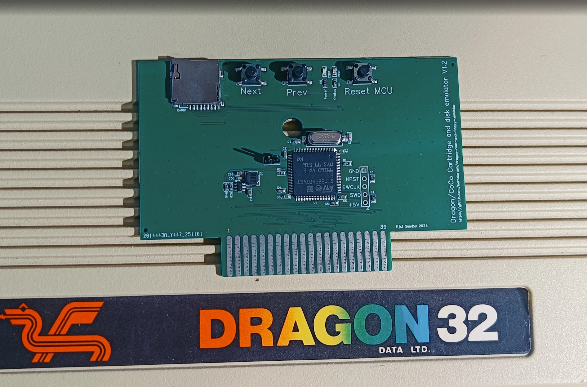
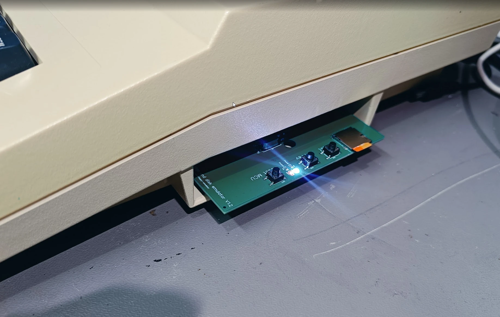
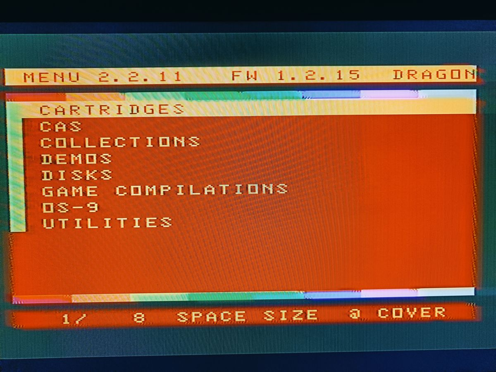

dragon-rom-and-floppy-emulator
==============================

Also now works on the Tandy Color Computer (tested on a Coco 2, but probably works on Coco 1 as well). 

How to use it: see [MANUAL.md](MANUAL.md).

The board
---------



There is a ready made board for this: the *Dragon/CoCo Cartridge and disk emulator* (Kjell
Sundby, 2024). It is an STM32F407VGT6 on a PCB that fits a standard cartridge case, with a micro
SD slot, NEXT, PREV and Reset MCU buttons, Power and Status LEDs, the Dragon/CoCo jumper and an
SWD header for programming. Boards can be had for a small sum: get in touch with me,
[@sundbyk](https://github.com/sundbyk), here on GitHub.



NOTE: on board V1.2 cartridge pin 40 (!DSD) is not connected, so a BASIC ROM of your own
(dragon.rom / coco.rom) can not be used with it. The next version of the board will have it.
Everything else works. You can also build one yourself from an STM32F407 development board, as
described under 'Wiring it' below.

This is a further development of kernelcrash's original code:
https://github.com/kernelcrash/dragon-rom-and-floppy-emulator. Added here: a second floppy drive,
cassette (.cas) loading, a BASIC ROM of your own, folders, covers and more in the menu, and an
SD card bootloader for firmware upgrades. The menu (KCDFS/KCCFS in the original) is now just
called MENU.

More info at  https://www.kernelcrash.com/blog/emulating-roms-and-floppy-disks-on-the-dragon-32/

Note the 'Wiring it' section below if you've built the earlier version. There are some changes.

Some text is from Crash Kernel's GitHub!

Overview
--------
- Emulates ROMs and floppy disks for the Dragon 32 and Tandy Color Computer 2 (and possibly Dragon 64 and other similar machines)
  Both the Dragon and Tandy machines are very very similar at a technical level, and there are only minor differences when it comes to
  floppy interfacing.
- Take a cheap STM32F407 board (US$10 or so 'before the chip shortage'). Wire it into the dragon/tandy cartridge slot..
- Make a FAT32 partition on a micro SD card and put rom and dsk/vdk disk images on it.
- Plug the micro SD into the STM32F4 board.
- The STM32F4 board presents a rom image in real time to the Dragon or Tandy computer such that it thinks a rom cartridge is attached.
- It can also emulate a WD2797 floppy disk controller such that you can load disk images off the SD card. It will emulate
  a Dragon DOS (or other DOS) ROM cart at the same time.


Wiring it
---------

Using a STM32F407VET6 or STM32F407VGT6 board
```
   PA2         - wire a button between it and GND. No need for a pullup. This is 'NEXT'
   PA3         - wire a button between it and GND. No need for a pullup. This is 'PREV'
   PA4         - wire to a two pin jumper. Wire the other pin to GND. No need for a pullup. When you 
                 set the jumper to tie PA4 to GND it means the board is in Tandy Coco mode. When 
                 you don't have a jumper in place to GND it means the board is in Dragon 32 mode.
   PA5         - !DSD (p40). Only needed for a BASIC ROM of your own (see dragon.rom below)

   PE0 to PE15 - A0 to A15
   PD8 to PD15 - D0 to D7

   PB6         - connects to PC4
   PB7         - E (p6) (see further down. _E connects to both PC0 and PB7)

   PC0         - E (p6)
   PC1         - _CTS (p32) (the cartridge chip select)
   PC2         - _P2 (p36)  (the $FF40-$FF5F chip select)

   PC3         - R/_W (p18)
   PC4         - PB6

   PC5         - _RESET

   PC6         - CART (PIA1 CB1) (note: CART is connected to Q for a real cartridge)
   PC7         - _NMI

   PC13        - _HALT (only required for Tandy mode)

   GND         - GND
```
Looking at the cartridge socket (pin 1 and 2 are towards the rear of the computer)
```
       1  +12V           2  +12V
       3  !HALT - PC13   4  !NMI - PC7
       5  !RESET - PC5   6  E (main clock) - PC0 & PB7
       7  Q (leads E)    8  CART (PIA1 CB1) - PC6
       9  +5V           10  D0 - PD8
      11  D1  - PD9     12  D2 - PD10
      13  D3  - PD11    14  D4 - PD12
      15  D5  - PD13    16  D6 - PD14
      17  D7  - PD15    18  R/!W - PC3
      19  A0  - PE0     20  A1 - PE1
      21  A2  - PE2     22  A3 - PE3
      23  A4  - PE4     24  A5 - PE5
      25  A6  - PE6     26  A7 - PE7
      27  A8  - PE8     28  A9 - PE9
      29  A10 - PE10    30  A11 - PE11
      31  A12 - PE12    32  !CTS ($C000-$FFEF) - PC1
      33  Ground        34  Ground
      35  Ext sound src 36  !P2 (PIA2 $FF40-$FF5F) - PC2
      37  A13 - PE13    38  A14 - PE14
      39  A15 - PE15    40  !DSD (Device Select Disable) - PA5
```

A BASIC ROM of your own
-----------------------
Put dragon.rom (Dragon mode) or coco.rom (Coco jumper on) in the root of the SD card and it is
used instead of the computer's own BASIC ROM: 16K for $8000-$BFFF, or 8K for $A000-$BFFF
(Color BASIC on its own, $8000-$9FFF are then $FF). For those addresses, and the vectors at
$FFF0-$FFFF, the stm32f4 pulls !DSD (cartridge pin 40) low, which keeps the computer's own ROM
off the bus, and puts its copy there instead. It does it early, while E is still low. While the
SAM is in map type 1 (a write to $FFDF, RAM at $8000-$FEFF) $8000-$BFFF are left alone.

The ROM takes over when the reset vector is next read. At power on the computer has already
started on its own ROM, so the menu does a cold start (JMP [$FFFE]) when it sees the new ROM
waiting. Take the file off the card to go back to the computer's own ROM.

With both dragon.rom and coco.rom on the card the menu asks which one to use at power on: 1 for
dragon.rom, 2 for coco.rom, 3 for the computer's own. The one chosen sets Dragon or Coco mode too
(dragon/ or tandy/, the DOS ROM and the menu's keyboard routine), whatever the jumper says. With
only one of them on the card, it is used when it matches the jumper, as before.

$FFFF only counts as the second half of the reset vector straight after $FFFE: the 6809 also
puts $FFFF on the bus on its dead cycles, just before nearly every read and write, and !DSD
must be high again for those. PA5 is push-pull for the same reason. NOTE: PA5 is not 5V tolerant.

Only put the file on the card when pin 40 is wired to PA5. Without it both ROMs drive the bus.
A Coco ROM in a Dragon (or the other way round) runs, but the keyboards are wired differently.

If you get a board with a microSD card slot, then the 'standard' wiring of the SD adapter
is fine.

The  DEVEBOX stm32f407 board I used during development has an LED attached to PA1, so various errors will result in PA1 flashing.

Setting up the micro SD card and using it
-----------------------------------------

I tend to format a micro SD card with a smallish partition (less than 1GB) with 
FAT32. If the board is in Dragon mode then you need:

  - A directory called 'dragon' containing .rom and .vdk files
  - a file called dragondos.rom in the root of the SD card. It will be 
    Dragon DOS 1.0 or SuperDOS

If the board is in Tandy mode:

  - A directory called 'tandy' containing .rom and .dsk files
  - a file called tandydos.rom in the root of the SD card. It will be 
    RS-DOS 1.1 or similar

Only .rom, .ccc and .bin (cartridges), .dsk and .vdk (disks) and .cas (cassettes) are used.
Hidden files and anything starting with a '.' (such as the ._ files macOS leaves behind) are
skipped. .cas files can only be started from the menu, NEXT and PREV skip them.

The order in which you copy files into the dragon or tandy directories is 
the order they will appear when you are cycling through disks or roms with NEXT and PREV
(ie. its not alphabetical). The menu sorts them by name.

If you then plugged the stm32f4 board in as described, then the Dragon or Coco
will look at the first file in the dragon or tandy directory and 'present' it.
If that file is a .rom file then the computer will see that as a cartridge at
0xC000. If its a .vdk or .dsk file then the appropriate DOS rom is loaded as a
cartridge at 0xC000 and you boot into BASIC. If you type DIR then you should see
a directory listing of that first .vdk or .dsk file.

Assuming you have presented a disk, if you press NEXT, then do a DIR again
(or power off/on the Dragon) then you should get a directory listing of the 2nd
disk you copied to the dragon directory and so on. PREV can be used to go to the
previous disk image.

It's not a bad idea to power the stm32f4 board separately so you can power off/on
the dragon when necessary without resetting the stm32f4 board to its first disk 
image (ie. make sure GND is connected from the Dragon to the stm32f4 board, but
leave +5V disconnected). Given that you can intermix .rom and disk image files 
in the dragon or tandy directory you can end up swapping out the DOS rom to 
replace with a different ROM. Chances are you would crash the computer at that
point. ie. it's best to power off/on the Dragon/Coco.

There is also a special ROM called menu.rom. If you have built it using lwtools
(see the build.sh script), you can copy menu.rom to the root of the SD card as
well. If you power off your Dragon or Coco, and reset the stm32f4 board, the Dragon
or Coco should now load the menu.rom at 0xC000 and show a disk/rom menuing system
called MENU.
From the menu you can select a disk image or ROM and the Dragon or Coco will then boot
into what you selected (ie. if you chose a rom it will boot that ROM. If you
chose a disk, it will boot into BASIC with a DOS loaded and the disk image
in the first drive)

Autoboot (Dragon, DragonDOS)

In Dragon mode a disk starts by itself. When the stm32f4 presents a disk it looks at the
DragonDOS directory on it, picks a command, and patches the DOS rom so the command is typed at
the first OK (see autoboot.c and autoboot.s). It picks, in this order:

1. MENU, M, AUTO-RUN, AUTOEXEC, AUTORUN or AUTO, as .BAS (RUN"M") and then as .BIN
   (LOAD"M.BIN":EXEC). Most game collections have an M.BAS menu.
2. BOOT, if the disk is bootable ("OS" at the start of track 0 sector 3).
3. The only .BAS on the disk, or the only .BIN if there is no .BAS, or a FOO.BAS with its
   FOO.BIN when there are no more than two .BAS files.
4. DIR, if it can not tell.

To choose for yourself, put a text file next to the disk with the same name and .run instead
of .vdk/.dsk (eg. Amiga_ball.run next to Amiga_ball.vdk) with the command on the first line,
eg. `RUN"DEMO"`. An empty .run file means nothing is typed for that disk. A file called
autoboot.off in the root of the SD card turns autoboot off for all disks.

This needs a DOS that ends its start up with JMP $8371, as DragonDOS 1.0 and 4.2 do (tried
with 4.2). With any other DOS rom nothing is patched. The
patch goes in the upper 8K of the cartridge space, which the 8K DOS rom does not use.

With menu.rom, the NEXT and PREV keys still operate as they should. So if 
say you had a disk image for a game. And the next disk was a blank disk you used
for game saves, then you just press NEXT when the game asks to save, and press
PREV to get back to the game disk. NEXT and PREV only change drive A. A second disk can go in
drive B from the menu (SHIFT+ENTER, see The menu below).

Normally to get back to the menu.rom you need to power down the Dragon or Coco and
also make sure the stm32f4 board is reset. However, there is a magic restart mode
whereby if you hold in the reset button of the Dragon or Tandy and then press the 
NEXT button, wait a second, then press the PREV button, then let go of the reset button
it will hopefully go back to the menu.rom. This won't work 100% of the time due to 
the way some games or software have been written. In that case you'll need to power
down the Dragon or Coco.

The board I have for sale have its own reset botton.

Emulated upper RAM (experimental)
---------------------------------

A first step towards running 64K software (OS-9, FLEX) on a 32K machine. The idea: keep the SAM
in map type 0, where $8000-$FEFF is ROM and cartridge and the computer's own RAM never sees those
addresses, and let the stm32f4 be 32K of RAM there instead. Reads of $8000-$BFFF come from the
board with !DSD (pin 40) low, as for dragon.rom, reads of $C000-$FEFF come from the board as for a
cartridge, and the board keeps every write to $8000-$FEFF. Needs pin 40 wired to PA5.

Put a file called ram64.on in the root of the SD card and reset the board. Then:

 - a write to $FF5F puts the RAM in place of the BASIC ROM and the cartridge
 - a write to $FF5E takes it away again (a reset of the computer does too)
 - reading $FF5E: bit 0 there is emulated RAM (ram64.on), bit 1 it is on

The same as the SAM's $FFDF/$FFDE, without the SAM. tools/ram64test.s (RAM64TEST.cas in the
disks folder) tries it out: it fills $8000-$FEFF with a pattern twice, reads it back, checks
that $1000-$2FFF was not touched, and that the BASIC ROM is back afterwards. Built with -D SAM it
uses $FFDF/$FFDE instead, and passes on an emulator with 64K of real RAM.

Still to come before 64K software can run: changing its writes to $FFDF/$FFDE into $FF5F/$FF5E
as it is read from disk, and the screen. The VDG only ever shows the computer's own RAM, and
FLEX and Dragon 64 OS-9 put their screen in the upper 32K.

Copying the firmware to the stm32f407 board
-------------------------------------------

The flash is split in two:

```
0x08000000 - 0x0800FFFF   SD card bootloader (bootloader/bl_main.c)
0x08010000 - 0x0807FFFF   the emulator
```

`make` builds both, plus these files:

- `dragon-rom-and-floppy-emulator-full.bin` (and `.hex`): bootloader and emulator together.
  Write this to 0x08000000 the first time, with an ST-Link or over USB DFU (set BOOT0, plug in
  USB, use STM32CubeProgrammer or dfu-util as in transfer.sh, then remove BOOT0 again).
- `upgrade.bin`: the emulator on its own, for upgrading from the SD card.

Upgrading from the SD card
--------------------------

Copy `upgrade.bin` to the root of the SD card and reset the stm32f4 board (or power it up).
The emulator sees the file, hands over to the bootloader, which flashes it, checks it and deletes
upgrade.bin. Then the board restarts with the new firmware. The LED on PA1 flickers while it
is flashing. The menu shows the firmware version in its top line.

- If the file is not an emulator image (for example the -full.bin by mistake) it is renamed to
  upgrade.bad and nothing is flashed.
- If the power goes during the upgrade, the bootloader sees there is no complete emulator and
  tries again at the next power up, as long as upgrade.bin is still on the card.
- A steady blink on PA1 means there is no working emulator and nothing to flash. Use DFU or an
  ST-Link.

The top line of the menu reads eg. `MENU 2.2.15  FW 1.2.19`. The last number of each is
a build number that counts up by itself: `make` keeps the firmware's in build_number, and
menu/build.sh keeps the menu's in menu/build_number (run build.sh from the menu folder).
So every new upgrade.bin or menu.rom shows a different version. Bump the first part
(FIRMWARE_VERSION in defines.h, TITLE in menu.s) for new features.

The menu
--------



In the menu directory is menu.s. It's a 6809 assembly program for the 
Dragon or Coco that can communicate to the stm32f4 board in order to show a list of all the 
files in the dragon directory of the SD card. You need lwtools to assemble it
into menu.rom that you need to put in the root of the SD card (see build.sh).
It also builds menu-sim.rom, which has a built in list of names so you can try the
menu out in an emulator such as XRoar without the stm32f4 board.

After reset of the stm32f4 board it should load menu.rom and present it.
So if you want to 'get back to the menu', you can power down the
Dragon or Coco and hit reset on the stm32f4 board, then power on the Dragon. Sometimes
you can get away with just holding in the reset button of the Dragon, then tap
reset on the stm32f4 board, then let go of the Dragon reset button.

The menu shows one folder at a time, 12 entries to a page, in orange on black: ".." first
(when you are below dragon/ or tandy/), then the folders, then the roms, disks and
cassettes, each sorted by name. A yellow block in front of a name means a folder, cyan a disk
image, magenta a rom, white a .cas, and a letter after the block says the same: D, R or C.
The disks in drive A and B have an inverted A or B instead of the D. It copes with up to 2000
entries per folder. Names are shown with up to 28 characters (23 while the sizes are shown). The top line shows the menu
version, the firmware version and whether the board is in Dragon or Coco mode. Below the
list is the folder you are in (eg. /GAMES/ARCADE), or a coloured stripe at the top.

So you can sort the collection into folders like dragon/games, dragon/utilities,
dragon/os9 and so on. When you come back to the menu it starts in the folder and on the
entry you last started. NEXT and PREV step through the roms and disks in that folder.

```
UP / DOWN       move up and down the list (wraps round). Held down, they repeat
LEFT / RIGHT    previous / next page. Held down, they repeat
letters, digits jump to the first name starting with what you have typed so far.
                A key that matches nothing is ignored
SPACE           show or hide the file sizes (in K) on the right. Once you have started
                typing a name, SPACE is part of the name
@               show the cover full screen. ENTER starts the game, any other key goes back
CLEAR           start typing the name again
ENTER           open the selected folder, or start the selected rom, disk or cassette
SHIFT+ENTER     on a disk: put it in drive B, or take it out again if it is in there. The
                menu stays, so the disk for drive A can be started next. The row under the
                title shows what is in drive B. It stays there over resets
BREAK           up one folder. At the top: BASIC's OK (reset brings the menu back)
```

Covers

A cover is a PMODE 4 screen (256x192, black and buff), 6144 bytes, in a .pm4 file: Game.pm4 next
to Game.cas (or .vdk, .rom ...), or cover.pm4 in the folder (for a folder, the one inside it).
tools/make_covers.ps1 makes them from a scanned inlay, cutting out the front. tools/organise_sd.py
tidies a collection into dragon/ and lists the covers for make_covers.ps1. Folders can hold up to
1800 entries, the rest of the stm32f4's buffer holds the cover.

Cassettes (.cas)

The stm32f4 reads the .cas and hands the menu what is on the tape. The menu loads it straight
into RAM, the same as CLOADM or CLOAD would, and starts it:

- Machine code files are loaded at their load address and run from the exec address of the
  last one (EXEC on its own runs it again). If it returns, you get BASIC's OK. If one of them
  goes where the stack is (a game that fills all of RAM) it is just JMPed to, with nothing
  put on the stack, and has to set up its own.
- A BASIC program (saved in the normal tokenised way) is loaded and RUN is typed for you.
  If there is machine code in the same .cas it is loaded first.
- BASIC saved as text (SAVE "X",A) can not be loaded this way.
- Anything that reads more from tape itself will not work: a BASIC loader that does CLOADM,
  or a machine code loader with its own tape routine. There is no tape, so it waits for ever.
  Such a tape can be turned into one that works, see below.

Tapes with their own loaders

tools/cas_snapshot.py lets XRoar load the tape the real way, and takes a snapshot when the tape
motor goes off for the last time. It writes that out as a new .cas: all 32K of RAM as one
machine code file, then a file of type 'S' with the PIA and SAM registers and the 6809's
registers. The menu copies RAM in, puts the PIAs and SAM back, and carries on from the
registers with an RTI, as if the tape had just finished. This covers BASIC programs that CLOADM
the rest, turbo loaders, protected tapes and so on. It does not cover games that load more
later (levels from tape). The snapshot is of a Dragon 32, so it may not work on a Dragon 64.

    python tools/cas_snapshot.py --xroar xroar.exe --batch list.txt --root dragon --out fixed \
        --report report.html -j 6

The report has a picture of the screen a few seconds after loading, to see which ones work.
Some tapes need more:

- --motor-left-on: for games that start with the tape motor still on. If the motor is still on
  after --limit seconds (say 60), the machine is read as it is then, over XRoar's GDB target.
- --type 'PCLEAR1\rCLOAD\rRUN\r': type this instead of letting XRoar -run the tape, eg. for
  BASIC programs too big to CLOAD with the usual 4 graphics pages (?OM ERROR).
- --xroar-arg=...: anything else for XRoar.

Coco tapes (for the tandy/ folder) need the same treatment: most Coco games have a loader of
their own or start themselves by loading over the vectors, and the menu then just shows stripes.
Snapshot them on a Coco with no cartridge, or Disk BASIC's hooks end up in the snapshot:

    python tools/cas_snapshot.py --xroar xroar.exe --batch list.txt --root tandy --out fixed \
        --xroar-arg=-machine --xroar-arg=coco --xroar-arg=-ram --xroar-arg=32 \
        --xroar-arg=-no-machine-cart

They also run on a Dragon 32 with coco.rom on the SD card (as checked in XRoar), but games
that read the keyboard themselves, and not through BASIC, see the Dragon's keys in the wrong
places.

Run one batch at a time, as each uses the same GDB ports.
tools/fix_galactic_gus.py is an earlier, hand made fix for Galactic Gus (Quickbeam): plain
machine code files, made by doing what its loader does.

When looking for the sync byte, a $3C that is not just after the $55 leader and gives a bad
checksum is taken to be in a gap between blocks and skipped.

Pressing reset on the Dragon/Coco brings the menu back.

The protocol;

 - The menu reads 0xff50. Bit 6 reflects the Tandy/Dragon jumper setting on 
   the stm32f4 board. A 0 means Tandy mode. A 1 means Dragon mode. Bit 5 is 1 when a BASIC
   ROM of its own (dragon.rom or coco.rom) is waiting for a reset; the menu then does a cold start.
   Bit 4 is 1 when both are on the card: the menu asks which one, writes 0 (the computer's own),
   1 (dragon.rom) or 2 (coco.rom) to buffer address 0x0006 and then 0x08 to 0xff50, and waits
   for bit 7 to go low.

 - BREAK at the top folder: the menu writes 0x04 to 0xff50 and waits for bit 7 to go low. The
   stm32f4 stops toggling CART until the next reset, as for a .cas, and the menu warm starts BASIC.

 - SHIFT+ENTER on a disk: the menu writes the entry number to 0x0000, then 0x02 to 0xff50, and
   waits for bit 7 to go low. The stm32f4 puts the disk in drive B (or takes it out if it is the
   one in there), and writes its name to 0x0060 ("" for none) for the menu to show.

Drive B: each drive has its own track buffer and head position. Writing the drive select bits
of the latch ($FF40 on the Coco, $FF48 on the Dragon) switches between them, so a DOS can go
from one drive to the other without seeking, as with real drives. Drive A is always ready,
drive B only with a disk in it, and the third and fourth never are. A track that has been
written to goes back to the image of the drive it belongs to.

 - The menu writes an 0x80 to 0xff50. That triggers the main thread of the 
   stm32f4 board to read the current folder (dragon/ or tandy/ to begin with), keep
   only the folders and the rom and disk images, and sort them.

 - The menu polls 0xff50 to see when bit 7 goes low. That means the listing has
   completed. The number of entries is at 0xff52/0xff53 (low byte first).

 - To open a folder (or "..") the menu writes its entry number to 0x0000 in the buffer
   (see below), writes 0x20 to 0xff50 and polls for bit 7 going low again. The new
   folder's list is then in the buffer, just as after 0x80.

 - 0xff54 and 0xff55 are a 16 bit address register into a 64K buffer in the stm32f4
   (low byte at 0xff54, the opposite way round to the 6809). Each read or write of
   0xff56 reads or writes the byte at that address and moves the address on by one.
   The buffer holds
```
0x0000        - selected entry number, 16 bit, low byte first. Written by the menu
0x0002        - entry to start on, 16 bit, low byte first
0x0008        - entry number of the disk in drive A in the folder shown, 16 bit, low byte
                first. 0xFFFF if it is not in this folder
0x000A        - the same for drive B
0x0010        - firmware version, 0 terminated
0x0060        - name of the disk in drive B, 0 terminated. Empty if there is none
0x0020        - folder being shown below dragon/ or tandy/, eg "/GAMES/ARCADE". Empty at
                the top. At most the last 32 characters, 0 terminated
0x0100        - the entries, 32 bytes each. Entry n is at 0x0100 + n*32
                byte 0      'U' for "..", 'F' for a folder, 'D' for a disk image, 'R' for a
                            rom, 'C' for a .cas
                byte 1-29   the name without the extension, 0 terminated (at most 28 characters)
                byte 30-31  the size in K, low byte first. 0 for folders
```

 - For a .cas, the menu writes 0x40 the same way, but the stm32f4 leaves the rom alone. It
   replaces the entries at 0x0100 with what is on the tape (16 bit numbers high byte first):
   'M' exec load length and the bytes for each machine code file, then 'B' length and the
   bytes for a BASIC program if there is one, or 'S' length and the machine state for a
   snapshot tape (see tools/cas_snapshot.py), then a 0. Or 'E' and a message if the file
   could not be used. the menu copies it all into RAM and runs it. The stm32f4 also stops
   toggling CART until the Dragon/Coco is reset, so the menu does not start again.

 - When the user picks an entry, the menu writes its number to 0x0000, then writes 0x40
   to 0xff50. That triggers the main thread of the stm32f4 board to load the rom, or
   the DOS rom and the disk image. Since the cartridge rom is swapped out underneath it,
   The menu does this last bit from RAM: it polls 0xff50 until bit 7 goes low (done), then
   cold starts the computer.

__Summary__
```
0xff50        - command register
0xff51        - spare
0xff52/0xff53 - number of entries (0xff52 is the low byte)
0xff54/0xff55 - address register into the buffer (0xff54 is the low byte)
0xff56        - byte to read from the buffer OR byte to write to the buffer
```

Technical
--------------------------

When E goes low (-ve edge) it triggers TIM4 (PB7) to generate a one-pulse in 190
or so nanoseconds. The one-pulse comes out of PB6. PB6 is connected to PC4 to
generate an EXTI4 interrupt. What this all means is that the first line of the 
EXTI4 interrupt handler is often executed 290ns or so from the fall of E. That may
seem silly as generally E is low for about 550ns when the 6809E is clocked at 
0.9MHz. But if a program uses 'the speed poke', then E is potentially low for
half the time (ie. 280-ish ns). Either way, at the start of the EXTI4 interrupt
handler, we wait for E to be high.

So now E has gone high, we can read the address bus to see 

 - Is it a ROM read?
 - Is it a P2 peripheral access?

ROMs are accessed at 0xc000 to 0xffef with some holes along the way. The !CTS pin
goes low , so its easy to tell its a ROM access. As soon as this is detected it's
a mad dash to look at the address bus of the 6809, then grab the appropriate byte
from a ROM that was already preloaded into the stm32f4's RAM earlier, then change 
the databus such that the stm32f4 can output the byte, then  wait for E to go low.
And as soon as it goes low tri-state the databus bins and exit the interrupt routine.

The P2 peripheral access is different depending if we are in Dragon or Tandy mode

 - - The Dragon has a WD2793 or similar at 0xff40 to 0xff43, and a related latch at 0xff48
   - The Tandy has a similar FDC at 0xff48 to 0xff4b, and it's related latch at 0xff40

Regardless of the mapping, the FDC and latch are emulated.

A key difference between this and the previous floppy emulation stuff I've done is 
that the Dragon and Tandy use interrupts. It varies a bit between the Dragon and
Tandy though

- In the Dragon the DRQ from the FDC goes to the CART cartridge pin
which is an edge trigger on one of the 6821s. And the INTRQ goes through some gates
to NMI on the 6809. Essentially bit 5 of that latch at 0xff48 can mask or unmask the
INTRQ. If the latch has bit 5 high then a high on INTRQ will drive NMI low causing
an NMI interrupt.

- In the Tandy the INTRQ pin on the FDC is gated to connect to _NMI. It actually uses
the DENSITY bit of the latch to do this. When DENSITY is high, _NMI can go low
when INTRQ goes high. For DRQ, it is gated by bit 7 of the latch such that
_HALT will go low only when DRQ is low and bit 7 of the latch are high.  That means
that _HALT will go low at the end of a DRQ rather than the beginning. There is
additional logic that says when INTRQ goes low that bit 7 of the latch 
will be forced low. So when INTRQ ends, _HALT must end up going high.

This interrupt stuff ended up quite interesting as you need to delay it a bit. Initially
this caused the branch that worked on the Dragon to be quite different to the one that
worked with the Tandy ... and this paragraph does not do justice to how long it took
to try to combine the two branches so the code base worked OK on both computers ;-)

Much of the code is a lift/shift of the msx-rom-and-floppy-emulator, so have a read 
of that if you are interested in the use of FPU registers and WFE stuff.

VDK disk files are effectively loading a track at a time into the STM32F4's RAM during
a WD2793 SEEK command. Requests to read or write sectors are effectively just reading
or writing into this track buffer. That should be fast, but as mentioned it has to 
be slowed down a fair bit to keep the 6809E happy.

VDK files that I've used seem to mostly be single sided, 40 track, with 18 sectors
of 256 bytes per track. The emulation assumes this sort of structure. 

The read and write sector WD2793 commands are implemented, but the read/write track
stuff is not. So that means it should work with most stuff, but don't try formatting
anything.

I've tested it with Dragon Dos 1.0 and 1.2 as well as SuperDOS E6. They seem to work.

I have tested the Tandy side with RS-DOS 1.1 (disk11.rom).

Note also that the _RESET signal of the Dragon is monitored. After the stm32f4 board
resets it makes sure the _RESET on the Dragon is high for a while to indicate that it
should be out of reset. The rationale is that before _RESET is stable at a high level
there is potentially a lot of erratic activity that could stuff up the EXTI interrupt
processing.

I found most Coco software is in DSK format which is just a raw dump of the 35 
tracks of 18x256 sectors. ie. filesize of 161280 bytes. For me this just means there
is no header anymore (which VDK files have).


About OS-9 and Nitros-9
--------------------------------------------
OS-9 and Nitros-9 for a Coco 2 with 64K should just work fine. Basically insert the disk, 
type DOS and you should see 'OS9 BOOT' or 'NITROS9 BOOT' and eventually the main OS-9 screen
and a prompt.

So OS-9 on Dragon does work. However OS-9 was designed for the Dragon 64
in the Dragon world. My Dragon 32 has had the 64K mod done to it and OS-9 does sort
of work on it. Per this page http://archive.worldofdragon.org/index.php?title=Dragon_32_-_64K_Upgrade
The OS-9 boot will hang due to the 6551 ACIA missing in a Dragon 32. So the 
basic deal for a modded Dragon 32 is

 - Insert the OS-9 disk for Dragon 64
 - Type BOOT
 - You should see 'OS9 BOOT' on the screen. 
 - Wait a few seconds
 - Press the reset button and you are back at the BASIC prompt. Enter

   POKE &HFF03,&H34:EXEC 9736

 - And you should see 'OS9 BOOT' on the screen again. Just wait a few seconds and
   you should see the main OS-9 screen and eventually a prompt.

I did look in to virtualising the ACIA, but the problem is that the primary PIA in a 
Dragon 32 is from FF00 to FF07, whereas in a Dragon 64 its from FF00 to FF03 with 
the ACIA from FF04 to FF07. You would need to at least cut the CS0/CS1 signals of the
primary PIA and then have an inverter between the CPU A2 and the CS0/CS1 signals. 
That would just lock the primary PIA to FF00 to FF03. Then I would need to write 
some code to send back some appropriate dummy values when FF04 to FF07 is read.

NitrOS-9 will work on the Dragon as well. In my case, none of the publicly 
downloadable images work with a 'Dragon 32 upgraded to 64K'. You will need to edit
level1/d64/makefile and set UPGRADED32 = 1 , then compile to generate new dsk images.

Thanks
------

I will note too that the xroar emulator and it's source was extremely helpful for
figuring out the interactions with the FDC (http://www.6809.org.uk/xroar/), even
though the floppy chip emulation code is still based mostly on fMSX.

Also the source code for Dragon DOS was enormously helpful too.
https://github.com/prime6809/DragonDOS


